# BangBang Server: Python vs Go — Feature Gap Report

> **Generated:** 2026-11-28 | **Python systems found:** 54 | **Go systems found:** 40 | **Go fully matched:** 22 | **Gaps:** 32

---

## Tổng quan

```mermaid
xychart-beta
  title "Feature Parity by Category"
  x-axis ["Combat", "Buff/CC", "Resource", "Movement", "Projectile", "Map Obj", "Modes", "Tank AI", "Stat Build", "Infra"]
  y-axis "Systems" 0 --> 12
  bar [5, 3, 2, 2, 2, 4, 5, 2, 4, 3]
  bar [4, 3, 1, 1, 1, 4, 1, 1, 0, 2]
```

> [!IMPORTANT]
> Thanh đầu (xanh) = Python, thanh sau (tím) = Go. Các nhóm Gap lớn nhất: **Game Modes** (5 vs 1), **Stat/Build Systems** (4 vs 0), **Tank Behaviors** (90+ vs 2).

---

## ✅ ĐÃ CÓ TRONG GO (22 hệ thống match Python)

| # | Hệ thống | Go Status | Ghi chú |
|---|----------|-----------|---------|
| 1 | Damage Calculation (ATK/DEF/Pierce/Armor, 3 schools) | ✅ Full | `combat.go` |
| 2 | Shield System (absorb before HP) | ✅ Full | `battle_tick.go` |
| 3 | Buff/Debuff (apply, stack, expire, cleanse, 13+ effect types) | ✅ Full | `buff_system.go` |
| 4 | CC System (stun/silence/root/confuse/unstoppable) | ✅ Full | `buff_system.go` |
| 5 | MP/Mana (cost, passive regen, buff regen) | ✅ Full | `battle_tick.go` |
| 6 | Skill Cooldowns (per-slot, CDR scaling, slot swap) | ✅ Full | `battle_tick.go` + behaviors |
| 7 | Bullet/Projectile (homing, wall clip, NPC collision) | ✅ Full | `battle_tick.go` |
| 8 | AOE Hits (circle/cone/rect, multi-target) | ✅ Full | `battle_aoe.go` |
| 9 | Map Walls (bullet vs movement, water separation) | ✅ Full | `map_objects.go` |
| 10 | Map NPCs (obstacles, turrets, repair boxes, bases) | ✅ Full | `map_objects.go` |
| 11 | Turret AI (auto-target, damage ramp) | ✅ Full | `battle_turret.go` |
| 12 | Drops/Powerups (air drops, kill drops, 7 pickup types) | ✅ Full | `battle_drops.go` |
| 13 | Capture/Occupy Flags (ModeType 2) | ✅ Full | `battle_flag.go` |
| 14 | Repair Box Heal (4% MaxHP/s, cooldown) | ✅ Full | `battle_repair.go` |
| 15 | Respawn System (dynamic delay, full HP/MP reset) | ✅ Full | `battle_tick.go` |
| 16 | Kill/Death/Assist tracking | ✅ Basic | Counts only, no streaks/multikill |
| 17 | Score System (per-camp) | ✅ Full | `battle_tick.go` |
| 18 | Settlement/End-game (1708 packet, honors) | ✅ Full | `handler_battle.go` |
| 19 | Actor Behavior Plugin (interface + hooks) | ✅ Full | `actor_behavior.go` |
| 20 | Tank Config (96 tanks, stats, skills) | ✅ Full | `tank_config.go` |
| 21 | Room System (create/join/leave/camp) | ✅ Full | `room.go` |
| 22 | Surrender Vote | ✅ Full | `battle_tick.go` |

---

## 🔴 THIẾU TRONG GO — Xếp theo Độ ưu tiên

### 🏆 Priority 1: Core Combat (ảnh hưởng gameplay trực tiếp)

| # | Hệ thống Python | Mô tả | Độ phức tạp | Python ref |
|---|-----------------|-------|-------------|------------|
| **G1** | **Heal Formula** | `heal()`: raw × outgoing_bonus × incoming_bonus × wound_reductions. Wound debuffs (poison/burn) reduce heal 30%. Go hiện chỉ cộng HP trực tiếp, không có heal modifiers. | 🟢 Nhỏ | `combat_math.heal()` |
| **G2** | **Lifesteal / Spell Vamp** | Crystal-based: attribute 28 (basic vamp), 29 (skill vamp). Chỉ apply trên actual HP loss (không overkill, không shield). Go chưa có. | 🟡 Trung bình | `crystal_combat.vamp()` |
| **G3** | **Damage Reduction chi tiết** | Python có 50+ buff-based reductions riêng (basic-only, skill-only, universal, missing-HP scaling). Go chỉ có generic `DamageReducePct`. | 🟡 Trung bình | `TankActions.damage()` L1182-1312 |
| **G4** | **Per-school Damage Immunity** | Python cho phép immune physical-only, energy-only, true-only. Go chỉ có generic immunity. | 🟢 Nhỏ | `TankActions.damage_immune()` |
| **G5** | **Projectile Blocking / Reflection** | Daredevil dodge, Luffy basic-block, Tsubasa/Kakashi reflect, Saitama block. Reflected bullets re-fire at attacker. Go chưa có. | 🔴 Lớn | `TankActions.projectile_blocked()` |

### 🏆 Priority 2: Stat & Build Systems (ảnh hưởng balance toàn game)

| # | Hệ thống Python | Mô tả | Độ phức tạp | Python ref |
|---|-----------------|-------|-------------|------------|
| **G6** | **Crystal/Rune System** | Frozen crystal builds → flat stats (HP, ATK, Armor, Pen) + % bonuses (CDR, speed, crit, vamp). HP regen from crystal attribute 26. Go chưa có. | 🔴 Lớn | `crystal_combat.py` |
| **G7** | **Military Rank System** | Rank stat bonuses + CDR contribution. Applied at actor construction. Go chưa có. | 🟡 Trung bình | `military_rank.py` |
| **G8** | **Booster System** | Flat stat modifiers from booster builds. Go chưa có. | 🟢 Nhỏ | `boosters.py` |
| **G9** | **Guild Skill System** | Active skill (slot 4) + passive guild skills (permanent buff templates 500101-508109). Weaken debuffs. Go có schema nhưng không có logic. | 🔴 Lớn | `guild_combat.py` |
| **G10** | **Dynamic Stat Computation** | `combat_stat()`: base × (1 + attr_bonus) + stat_loans × guild_weaken. Go có attr bonus từ buffs nhưng thiếu stat loans, guild weaken, crystal bonuses. | 🟡 Trung bình | `TankActions.combat_stat()` |
| **G11** | **Crit Rate from Crystals** | Python: crystal attribute 27 → crit chance. Go hardcoded 15%. | 🟢 Nhỏ | `crystal_combat.critical()` |

### 🏆 Priority 3: Game Modes (mở rộng nội dung chơi)

| # | Hệ thống Python | Mô tả | Độ phức tạp | Python ref |
|---|-----------------|-------|-------------|------------|
| **G12** | **Base Mode** (maps 12/14/50/169) | Robot NPC waves spawn theo timer. Battle Levels (1-20) với EXP từ kills → HP/ATK scaling + CDR bonus. Go có base HP win condition nhưng thiếu robots + levels. | 🔴 Lớn | `base_mode.py`, `battle_levels.py` |
| **G13** | **Death Mode** (maps 30/40) | Round elimination (best of 3). No respawn. 60s collapse timer + shrinking zone true damage. Go chưa có. | 🔴 Lớn | `death_mode.py` |
| **G14** | **Escort Mode** (map 70) | Cart race: speed scales with nearby friend count (0-5→0-80 speed). Cart damageable (7500 HP, 90% reduction). Win by progress. Go chưa có. | 🔴 Lớn | `escort_mode.py` |
| **G15** | **World Boss** (map 40002) | Shared HP boss, energy system (0-8 levels), bear adds, beam attack. Go có schema nhưng handler trả stub. | 🔴 Lớn | `world_boss_mode.py` |
| **G16** | **Cow/Totem/Fastfood Objectives** | Map-specific PvP objectives: cow escort, damageable totems, healing mascots. Go chưa có. | 🟡 Trung bình | `cow_objectives.py`, `totem_objectives.py`, `fastfood_map.py` |

### 🏆 Priority 4: Map Features (đa dạng hóa gameplay)

| # | Hệ thống Python | Mô tả | Độ phức tạp | Python ref |
|---|-----------------|-------|-------------|------------|
| **G17** | **Dynamic Water Walls** | ThuyTinh skill tạo tường nước 72×72 tạm thời 4s. Chặn CẢ đạn lẫn di chuyển (khác static water). Go chưa có. | 🟡 Trung bình | `BattleArena.water_rects()` |
| **G18** | **Portal System** (maps 35/40) | One-way teleporters with cooldown. Touch radius → instant teleport to exit. Go chưa có. | 🟡 Trung bình | `map_portals.py` |
| **G19** | **Lightning Map** (map 21) | Energy Towers buff allies (300 range). Electric Towers auto-fire true-damage chain lightning (450 range). Go chưa có. | 🟡 Trung bình | `lightning_map.py` |
| **G20** | **Quicksand/Tornado Map** (map 170) | Tornadoes follow patrol routes, knockup + slow on contact. Go chưa có. | 🟡 Trung bình | `quicksand_map.py` |
| **G21** | **Maya Map** (map 1) | Chieftain quest system, spider nest explosions. Go chưa có. | 🟡 Trung bình | `maya_map.py` |
| **G22** | **Intro/Pre-battle Lock** | 3s intro period: all input rejected, presentation stun/root/silence. Go starts immediately. | 🟢 Nhỏ | `BattleArena.__init__()` |

### 🏆 Priority 5: Tank Behaviors (cá nhân hóa hero)

| # | Hệ thống Python | Mô tả | Độ phức tạp | Python ref |
|---|-----------------|-------|-------------|------------|
| **G23** | **88 Tank Behaviors thiếu** | Python có 90+ tanks với unique mechanics. Go chỉ có 2 (Gundam, Wukong) + DefaultBehavior. Mỗi tank cần 200-500 LOC. | 🔴🔴 Rất lớn | `*_actions.py` × 90 |
| **G24** | **Melee/Displacement** | Forced motion, cone targeting, piercing projectiles, strip targeting. Go chỉ có basic AOE shapes. | 🟡 Trung bình | `melee_common.py` |
| **G25** | **Dash System chi tiết** | Dash flights với wall clipping, water wall shortening, `forced_until`. Go chỉ có Wukong blink. | 🟡 Trung bình | `TankActions._set_motion()` |
| **G26** | **Borrowed E (Kakashi)** | Copy skill E của tank khác via proxy view. Go chưa có. | 🔴 Lớn | `borrowed_e.py` |

### 🏆 Priority 6: AI & Multiplayer (trải nghiệm chơi)

| # | Hệ thống Python | Mô tả | Độ phức tạp | Python ref |
|---|-----------------|-------|-------------|------------|
| **G27** | **Bot AI** | 20+ personalities, pathfinding, target selection, teamwork. Go chỉ tạo solo room. | 🔴🔴 Rất lớn | `bot_ai.py` (66KB) + 20 files |
| **G28** | **Matchmaking Queue** | Real player-matching with ELO/rank. Go auto-starts solo. | 🔴 Lớn | `ranked_matches.py` |
| **G29** | **Battle Persistence / Reconnect** | Save/restore full battle state for reconnect. Go mất state khi disconnect. | 🔴 Lớn | `battle_persistence.py` |

### 🏆 Priority 7: Cosmetic & Supporting

| # | Hệ thống Python | Mô tả | Độ phức tạp | Python ref |
|---|-----------------|-------|-------------|------------|
| **G30** | **Skin Effects** | Translate packet IDs to cosmetic variants based on equipped skin. Go gửi base IDs. | 🟡 Trung bình | `skin_effects.py` |
| **G31** | **Kill Streaks / Multi-kill / First Blood** | Python tracks streaks (8s window), multi-kills, first blood. Go chỉ count K/D/A. | 🟢 Nhỏ | `pk_rules.py` |
| **G32** | **PvE Campaign** (9 chapters) | Solo campaign with scripted waves, bosses, puzzles, grading. Go chưa có. | 🔴🔴 Rất lớn | `pve_*.py` × 15 files |

---

## Thống kê tổng hợp

| Metric | Số lượng |
|--------|---------|
| Hệ thống Python tổng | **54** |
| Go đã match đầy đủ | **22** (41%) |
| Go thiếu hoàn toàn | **27** (50%) |
| Go có nhưng chưa đầy đủ | **5** (9%) |
| Tank behaviors cần port | **88** / 90 |
| LOC ước tính cần thêm | **~30,000-50,000** |

### Phân bổ theo độ phức tạp

| Độ phức tạp | Số gaps | Ước tính effort |
|-------------|---------|-----------------|
| 🟢 Nhỏ (< 100 LOC) | 6 | 1-2 ngày |
| 🟡 Trung bình (100-500 LOC) | 12 | 1-2 tuần |
| 🔴 Lớn (500-2000 LOC) | 10 | 2-4 tuần |
| 🔴🔴 Rất lớn (>2000 LOC) | 4 | 1-3 tháng |

---

## 🎯 Đề xuất thứ tự implement

### Phase 1: Combat Core (1-2 tuần)
1. **G1** Heal Formula — nhỏ, cần cho tank heal
2. **G4** Per-school Immunity — nhỏ, mở rộng buff system
3. **G11** Crit Rate variable — nhỏ, dùng crystal attribute
4. **G31** Kill Streaks / Multi-kill — nhỏ, UX improvement
5. **G22** Intro Lock 3s — nhỏ, polish

### Phase 2: Stat Systems (2-3 tuần)
6. **G6** Crystal/Rune System — lớn, ảnh hưởng balance
7. **G7** Military Rank — trung bình
8. **G8** Booster System — nhỏ
9. **G10** Dynamic Stat recompute — trung bình
10. **G3** Damage Reduction chi tiết — trung bình

### Phase 3: Tank Behaviors (ongoing)
11. **G23** Port top 10-20 popular tanks trước
12. **G24** Melee/Displacement utilities
13. **G25** Dash System chi tiết
14. **G2** Lifesteal/Vamp (cần crystals trước)

### Phase 4: Game Modes (2-4 tuần each)
15. **G12** Base Mode + Battle Levels
16. **G13** Death Mode
17. **G14** Escort Mode

### Phase 5: Map Features (1-2 tuần)
18. **G17-G21** Map-specific features

### Phase 6: AI & Infrastructure (long-term)
19. **G27** Bot AI
20. **G28** Matchmaking
21. **G29** Battle Persistence
